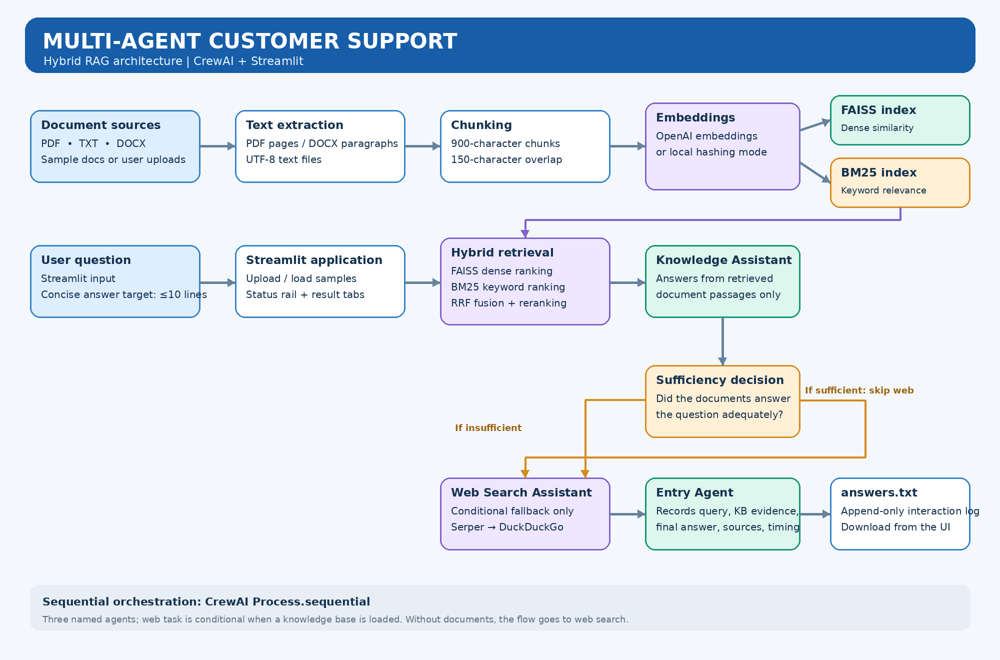

# Multi-Agent Customer Support

A Streamlit customer-support demo powered by CrewAI and **hybrid Retrieval-Augmented Generation (RAG)**. It searches uploaded documents first, falls back to web search only when retrieved evidence is insufficient, and records each interaction.



## Highlights

- Upload PDF, TXT and DOCX files, or load the bundled Nimbus sample documents.
- Extract text, split into overlapping chunks, and retrieve using FAISS dense similarity + BM25 keyword search, fused with Reciprocal Rank Fusion (RRF) and reranking.
- **Knowledge Assistant:** answers only from retrieved passages and explicitly assesses whether evidence is sufficient.
- **Web Search Assistant:** conditional fallback using Serper, with DuckDuckGo fallback when available.
- **Entry Agent:** records the question, knowledge-base findings, final answer, source details and timings in `answers.txt`.
- Live agent status rail, answer/source tabs, connection check and download of the interaction log.
- Final answer is capped at approximately 10 lines including source lines.

## Architecture and technical docs

- [`architecture.png`](architecture.png) — architecture diagram for GitHub
- [`docs/TECHNICAL_DOCUMENTATION.md`](docs/TECHNICAL_DOCUMENTATION.md) — components, data flow, configuration and design decisions
- [`docs/TESTING_GUIDE.md`](docs/TESTING_GUIDE.md) — local, fallback and regression test plan
- [`docs/architecture.mmd.md`](docs/architecture.mmd.md) — editable Mermaid source

## Requirements

- Python 3.11 or 3.12 recommended
- OpenAI API key for model responses; OpenAI embeddings are used when configured
- Serper key is optional; the app attempts DuckDuckGo fallback for web search
- Windows, macOS or Linux

## Windows setup (Command Prompt)

This project is configured to use the shared virtual environment in `D:\!Social Eagle AI\Social Eagle Labs\.venv`. If you use that shared environment, do **not** create a second venv inside this project.

```cmd
cd /d "D:\!Social Eagle AI\Social Eagle Labs"
.venv\Scripts\activate.bat
cd "Multi-Agent-Customer-Support-Claude"
python -m pip install -r requirements.txt
```

If you prefer an isolated environment instead, create and activate `.venv` inside this project folder before installing requirements.

Create `.env` from the example only if you do not already have one:

```cmd
copy .env.example .env
notepad .env
```

Set your keys in `.env`:

```dotenv
OPENAI_API_KEY=your-openai-api-key
SERPER_API_KEY=your-serper-api-key
OPENAI_MODEL=gpt-4o-mini
OPENAI_EMBED_MODEL=text-embedding-3-small
EMBEDDINGS_BACKEND=auto
```

`SERPER_API_KEY` is optional; `OPENAI_API_KEY` is needed for model answers. `EMBEDDINGS_BACKEND=local` selects the local hashing embedder; dense retrieval quality may differ from OpenAI embeddings, while BM25 remains available. Never commit `.env`.

Run the app:

```cmd
streamlit run app.py
```

## Quick demo

1. Click **Test connections** in the sidebar.
2. Click **Load samples** or upload PDF/TXT/DOCX documents.
3. Ask `How do I reset my password?` and check that the Knowledge Assistant answers from a relevant sample document; web search should be skipped when evidence is sufficient.
4. Ask `What is the latest stable Python version?` to test conditional web fallback when the loaded documents do not answer it.
5. Inspect the source details and download `answers.txt`.

## Tests

```cmd
python test_e2e.py
```

For live integration tests with configured credentials, follow the options documented in `test_e2e.py` and [`docs/TESTING_GUIDE.md`](docs/TESTING_GUIDE.md). Tests that call live APIs may incur charges.

## File structure

```text
Multi-Agent-Customer-Support-Claude/
├── app.py                    # Streamlit UI, RAG pipeline and CrewAI workflow
├── test_e2e.py               # Offline and optional live tests
├── requirements.txt          # Python dependencies
├── .env.example              # Configuration template; no real secrets
├── .gitignore                # Excludes secrets, caches and local interaction log
├── .streamlit/config.toml    # Streamlit theme settings
├── sample_docs/              # Bundled demo documents
├── architecture.png          # Architecture diagram
├── docs/                     # Technical and testing documentation
└── answers.txt               # Local interaction log; do not commit
```

## Limitations

- Scanned/image-only PDFs need OCR; this app reports files without a readable text layer rather than performing OCR.
- Retrieval relevance depends on document quality, chunking, embeddings and the query. Always inspect cited passages for high-impact decisions.
- Web availability depends on network access and the configured search providers.
- This is a buildathon/demo application, not an authenticated multi-user production service.

## Security and Git hygiene

- Keep `.env`, `answers.txt`, virtual environments, Python caches and local Streamlit state out of Git.
- Review sample documents and logs for sensitive content before publishing.
- Do not paste API keys into screenshots, issues or commits.
